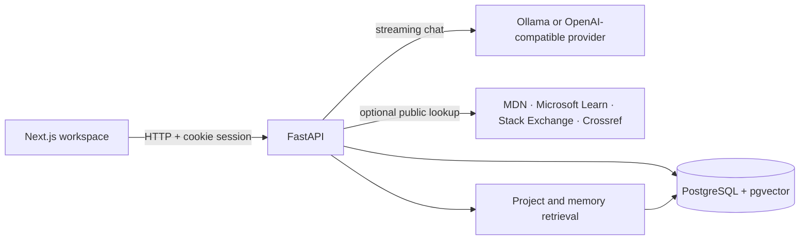

# Medha architecture

## Boundaries

- The browser handles workspace state and renders Markdown; secrets and provider credentials remain on the backend.
- FastAPI owns authorization, validation, project/document access, and model routing.
- SQLAlchemy uses a portable SQLite dialect for tests and PostgreSQL/pgvector for deployment.
- Project uploads are extracted to text, chunked, and stored with ownership metadata. Similarity search uses pgvector when embeddings exist; otherwise the same passages are ranked lexically.
- Research and public developer search responses are preserved as message sources. Retrieved text is marked as untrusted context in the model prompt.
- The model adapter supports Ollama's streaming chat protocol and OpenAI-compatible streaming chat completions.

## Isolation and execution

Every project, document, conversation, and memory query is scoped to the authenticated user. Uploaded source files are never executed. No shell, Python evaluator, terminal, or unrestricted URL fetch is exposed to the model.
